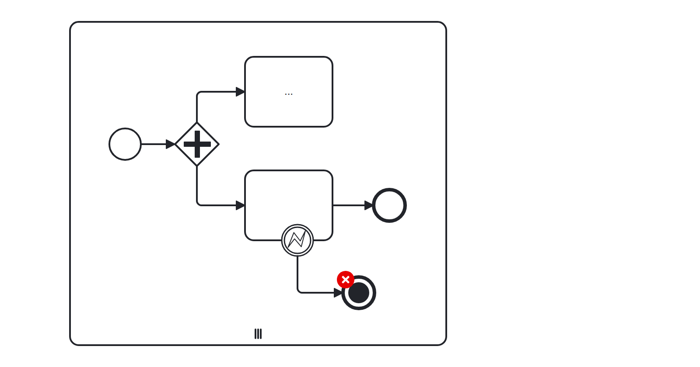
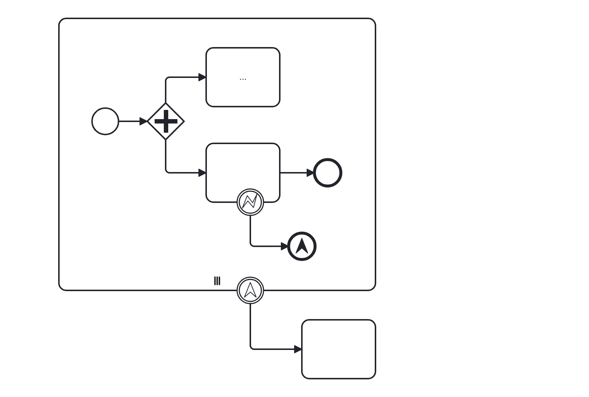
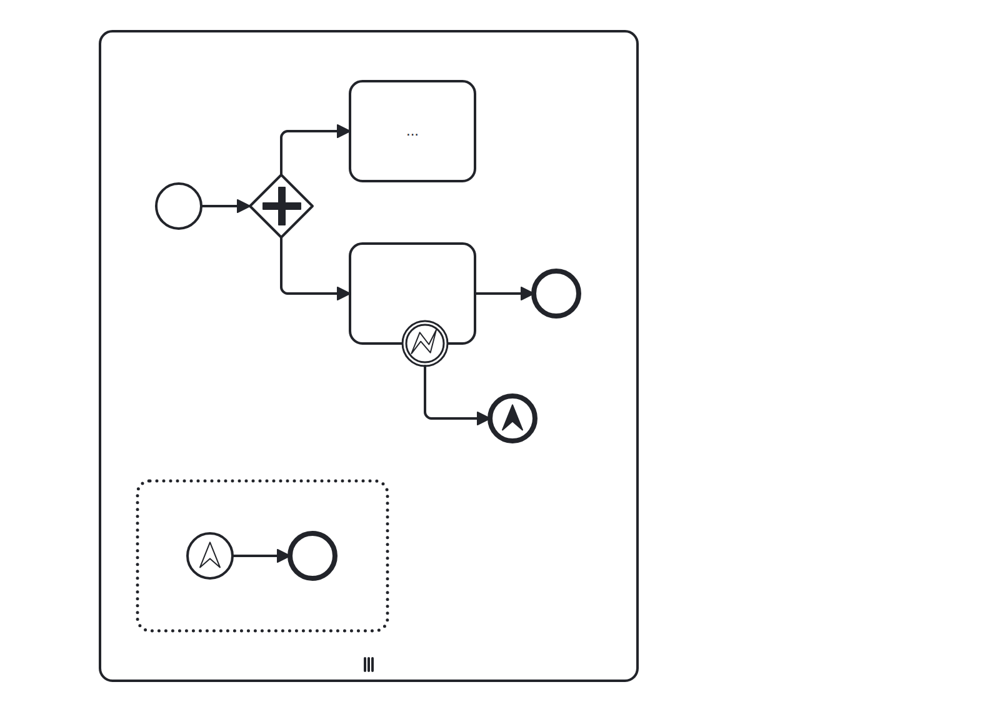

# No Multi-instance Termination (no-multi-instance-termination)

Warns when a terminate end event is used inside a multi-instance subprocess.
The semantics (terminate only the current iteration) are not obvious to non-BPMN experts.

Example of __incorrect__ usage for this rule:

Cf. [`no-multi-instance-termination-incorrect.bpmn`](./examples/no-multi-instance-termination-incorrect.bpmn).

Example of __correct__ usage, canceling all iterations:

Cf. [`no-multi-instance-termination-correct.bpmn`](./examples/no-multi-instance-termination-correct.bpmn).

Example of __correct__ usage, canceling one iteration:

Cf. [`no-multi-instance-termination-event-subprocess-correct.bpmn`](./examples/no-multi-instance-termination-event-subprocess-correct.bpmn).
